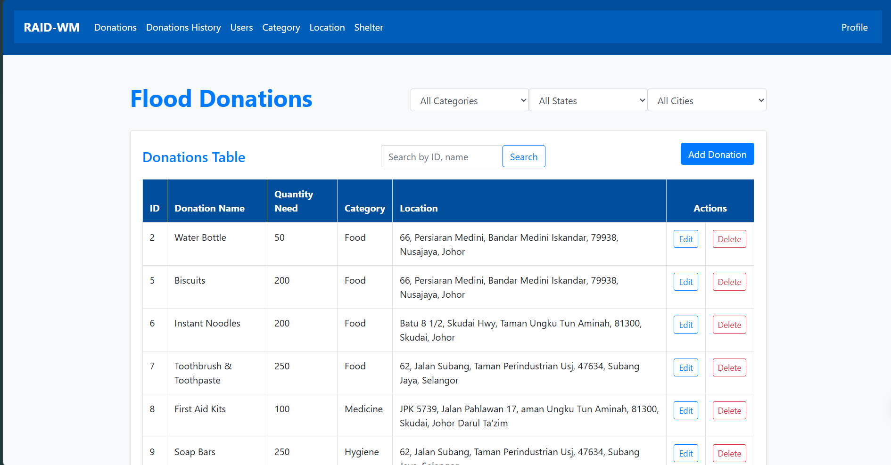
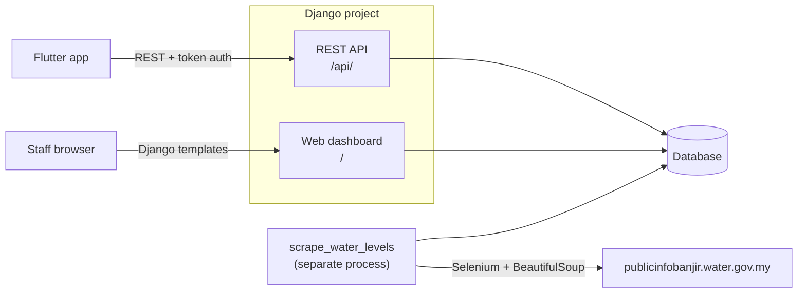

# Water Alert Backend

Django backend for a flood-preparedness app in Malaysia. It serves:

- a **REST API** for the [Flutter mobile app](https://github.com/chyiruay/FYP_Frontend):
  accounts, donations, flood shelters and river water levels
- a **staff web dashboard** for managing donation items, categories, locations, shelters
  and users
- a **scraper** that collects water-level readings for all 16 states every hour

<!-- Add a screenshot of the staff dashboard to docs/screenshots/ -->


## Architecture



### Water-level scraping

The government flood site has no public API, so the data is scraped from its HTML with
headless Chrome. Scraping all 16 states takes several minutes, so it never runs inside a
request:

- **`python manage.py scrape_water_levels`** runs as its own process (`--every 60` for
  hourly). It's not started from the web server, so it runs exactly once however many web
  workers there are, and never during `migrate` or `test`.
- **Every run is saved as a snapshot** (`WaterLevel.scraped_at`), so readings have history.
  `/api/water-level/` returns only the latest snapshot for a state. Snapshots older than
  30 days are deleted.
- **Failures are isolated per state.** If one state fails, or returns nothing because the
  page layout changed, that state keeps its previous snapshot and the others still update.
- **No Chrome needed for a demo:** `--from-file data/banjir_data.json` imports a saved
  scrape.

## Tech stack

Python 3.12 · Django 5.1 · Django REST Framework · SQLite (dev) · Selenium · BeautifulSoup ·
APScheduler

## Project structure

```
flood/                   project settings and root URLs
members/                 main app
  models.py              CustomUser, Donation, Category, Location, Shelter, WaterLevel, ...
  api_views.py           REST API (consumed by the Flutter app)
  views.py               staff web dashboard
  banjir_api.py          Selenium scraper for one state
  management/commands/
    scrape_water_levels.py   scheduled scraper → database
  fixtures/seed.json     reference data (categories, locations, donations, 13 shelters)
  tests.py
accounts/                web sign-up page
data/banjir_data.json    sample scrape, for running without Chrome
```

## Getting started

```bash
python -m venv .venv
.venv\Scripts\activate            # macOS/Linux: source .venv/bin/activate
pip install -r requirements.txt

python manage.py migrate
python manage.py loaddata seed                                     # reference data
python manage.py scrape_water_levels --from-file data/banjir_data.json  # sample water levels
python manage.py createsuperuser                                   # staff login for the dashboard

python manage.py runserver 0.0.0.0:8000
```

`0.0.0.0` lets a phone on the same Wi-Fi reach the server. Add your computer's LAN IP to
`DJANGO_ALLOWED_HOSTS` (see below).

To keep water levels up to date, run the scraper in a second terminal. It needs Google
Chrome installed:

```bash
python manage.py scrape_water_levels --every 60
```

### Configuration

| Variable | Default | Purpose |
|---|---|---|
| `DJANGO_SECRET_KEY` | insecure dev key | **Must** be set anywhere outside local development |
| `DJANGO_DEBUG` | `True` | Set `False` in production |
| `DJANGO_ALLOWED_HOSTS` | `127.0.0.1,10.0.2.2,localhost,…` | Comma-separated hostnames |

### Tests

```bash
python manage.py test
```

## API

All endpoints are under `/api/` and need `Authorization: Token <token>` unless marked public.

| Method | Endpoint | Description |
|---|---|---|
| POST | `register/` | Create an account *(public)* |
| POST | `login/` | Returns a token and the user's profile *(public)* |
| PUT | `update_profile/` | Update the logged-in user's profile |
| PUT | `change_password/` | Change password |
| GET | `donations/` | Donation items with remaining quantity |
| POST | `donation-records/` | Pledge a quantity of an item |
| GET | `donation-history/` | The logged-in user's donations |
| GET | `shelters/` | All flood shelters with coordinates and availability *(public)* |
| GET | `states/` | State codes and names |
| GET | `water-level/?state=JHR` | Latest water-level snapshot for a state |
| GET | `users/` | All users *(admin only)* |

## Known limitations

- **The scraper depends on the source site's HTML.** Columns are read by position, so a
  layout change breaks it. The per-state isolation stops that from wiping existing data,
  but it still needs a code fix.
- **SQLite** is fine locally. A deployment should use PostgreSQL, since many hosts have
  no persistent disk.
- **Shelters aren't filtered by distance on the server.** The app downloads all of them
  and sorts locally. A larger dataset would need a spatial query (e.g. PostGIS).
- **All models live in one app (`members`).** Splitting it into accounts / donations /
  shelters / water levels would make the boundaries clearer.
